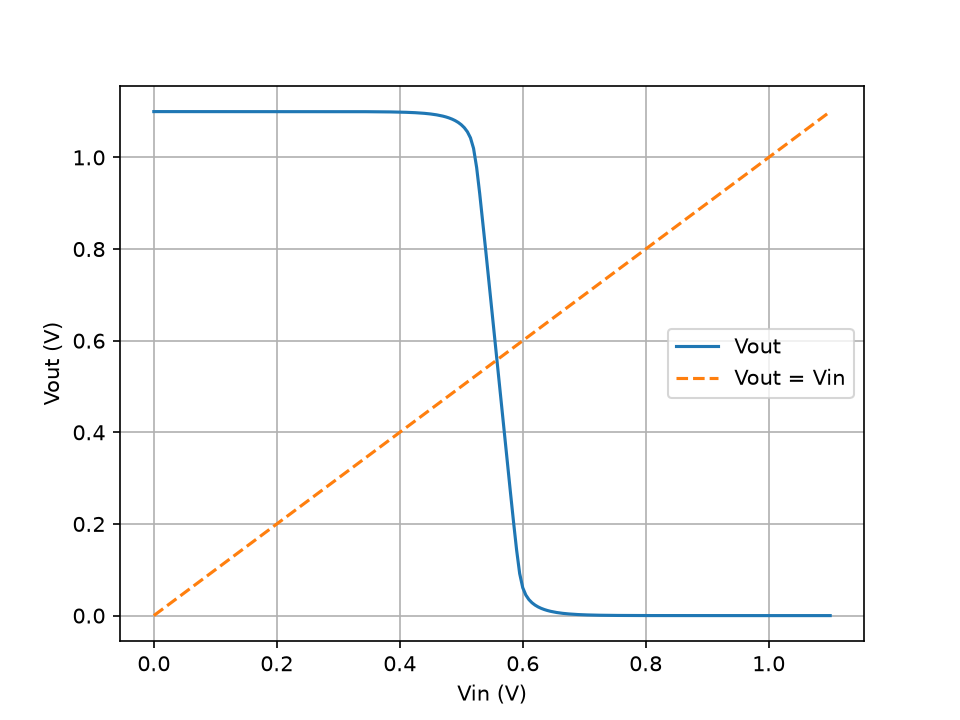
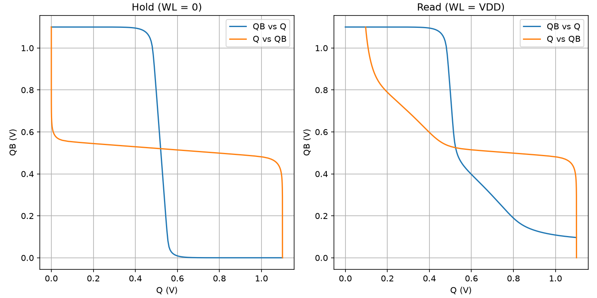
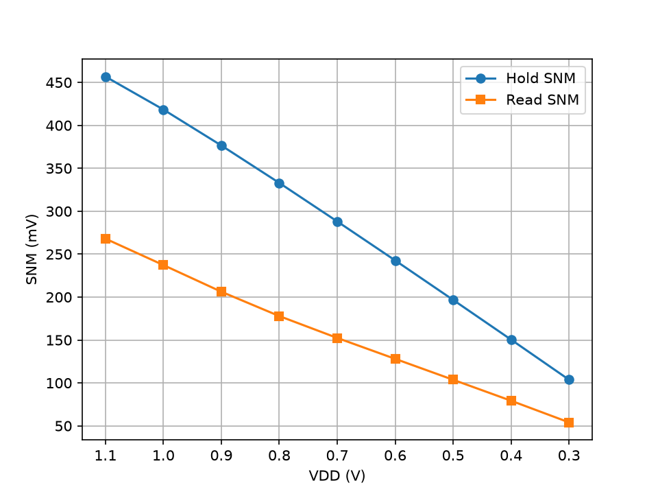
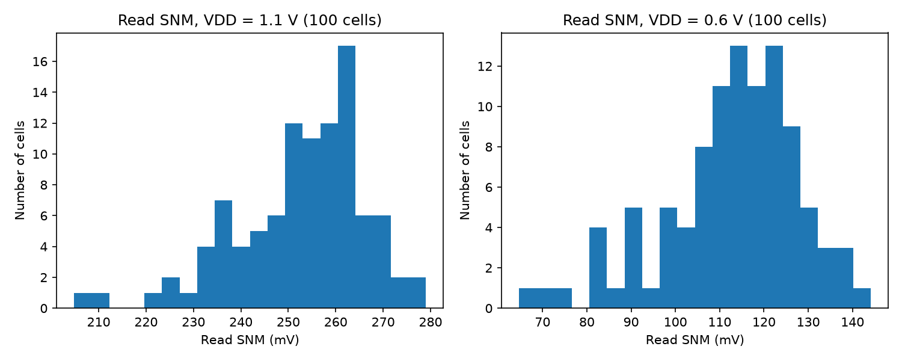
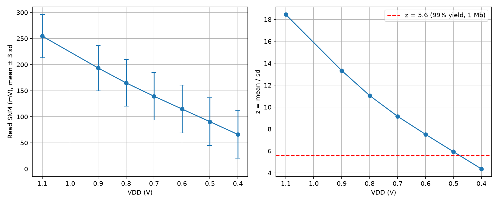
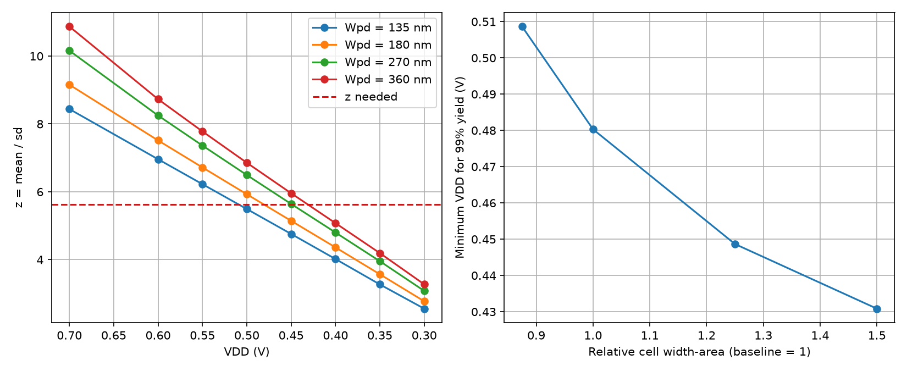
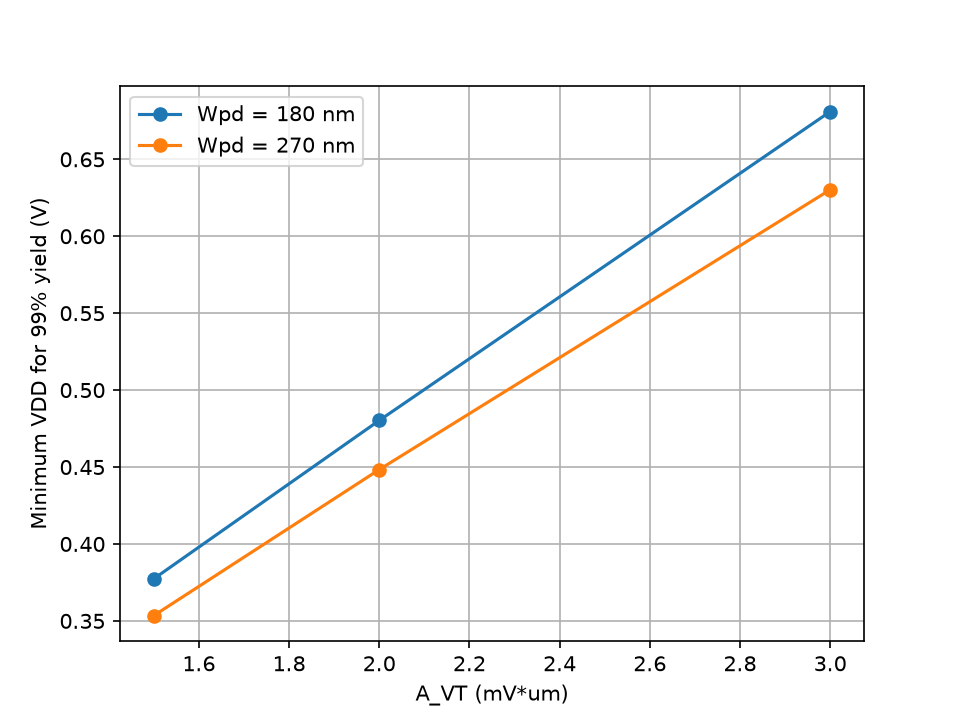

# SRAM Read-Stability Yield vs. Supply Voltage (45 nm Predictive Model, 6T Cell)

A simulation study of how low the supply voltage of a 6T SRAM cell can go before random transistor variation makes a 1 Mb array unreliable. It uses LTspice for circuit simulation and Python for automation, Monte Carlo sampling, and analysis.

**Author:** Nguyen Tan Vinh
**Status:** Simulation only. No hardware, no foundry PDK.

---

## Headline result

For the baseline cell (45 nm predictive models, assumed Vth mismatch coefficient A_VT = 2.0 mV·µm), the lowest supply voltage at which a 1 Mb array reaches **99% read-stability yield is about 0.48 V** (95% confidence interval from sampling alone: 0.45 to 0.51 V), compared with the 1.1 V nominal supply.

Two findings support the design conclusions:

1. **Wider pull-down transistors lower the minimum voltage, with diminishing returns.** Going from 180 nm to 270 nm lowers it by roughly 30 mV, and a further widening to 360 nm by roughly 20 mV more, at a cost in cell width.
2. **The absolute minimum voltage depends strongly on the assumed mismatch coefficient.** It moves by about 0.2 V per 1 mV·µm of A_VT (0.38 V at 1.5, 0.68 V at 3.0). The ranking of designs does not change.


## What the project does

1. Builds a CMOS inverter and a 6T SRAM cell in LTspice using the PTM 45 nm low-power (LP) bulk CMOS model.
2. Measures the cell's **static noise margin (SNM)** from butterfly curves, for hold and read conditions.
3. Automates LTspice from Python so thousands of cells can be simulated.
4. Adds random threshold-voltage (Vth) variation to each transistor using the Pelgrom relation, sigma(Vth) = A_VT / sqrt(W·L).
5. Runs Monte Carlo (300 cells per voltage) and converts the read-SNM distribution into a failure probability and an array yield.
6. Studies the effect of pull-down width and of the assumed A_VT, and checks the numerical reliability of the results.

### How yield is estimated

For each supply voltage, the read SNM of N = 300 random cells is collected. Then:

- z = mean(SNM) / standard deviation(SNM)
- per-cell failure probability P = Q(z), the Gaussian tail beyond z standard deviations
- array yield = exp(-cells · P), for a 1 Mb array (2^20 cells)

A 99% yield on 1 Mb requires z of about 5.6. The minimum voltage is where z crosses this value (linear interpolation between simulated voltages).

The static noise margin is the side of the largest square that fits inside the smaller eye of the butterfly curve, computed by rotating the curves 45 degrees (method of Seevinck et al., 1987).

---

## Cell and simulation setup

| Item | Value |
|---|---|
| Transistor models | PTM 45 nm LP bulk CMOS (BSIM4, level 54), nominal VDD 1.1 V |
| Channel length (all transistors) | 45 nm |
| Baseline widths | pull-down 180 nm, pull-up 90 nm, access 90 nm |
| Read condition | wordline at VDD, both bitlines at VDD |
| Hold condition | wordline at 0 V |
| Variation | independent Gaussian Vth shift per transistor, A_VT = 2.0 mV·µm (baseline) |
| Sigma(Vth), baseline | 22.2 mV (pull-down), 31.4 mV (pull-up and access) |
| Samples | 300 cells per voltage point |
| Random seed | fixed (seed 0), so results are reproducible |

---

## Results

### 1. Model check

A CMOS inverter (Wn = 90 nm, Wp = 180 nm) has a switching threshold of 0.560 V at VDD = 1.1 V, close to half the supply.



### 2. Nominal cell (no variation)

At VDD = 1.1 V: **hold SNM = 457 mV, read SNM = 268 mV.** The read margin is smaller because the access transistor disturbs the stored "0".



| VDD (V) | Hold SNM (mV) | Read SNM (mV) |
|---|---|---|
| 1.10 | 457 | 268 |
| 1.00 | 418 | 237 |
| 0.90 | 377 | 206 |
| 0.80 | 333 | 178 |
| 0.70 | 288 | 152 |
| 0.60 | 243 | 128 |
| 0.50 | 197 | 104 |
| 0.40 | 150 | 79 |
| 0.30 | 104 | 54 |



### 3. Monte Carlo with Vth variation (baseline cell)



| VDD (V) | Mean read SNM (mV) | Std. dev. (mV) | z = mean / sd |
|---|---|---|---|
| 1.10 | 255 | 13.8 | 18.5 |
| 0.90 | 194 | 14.5 | 13.3 |
| 0.80 | 165 | 14.9 | 11.1 |
| 0.70 | 139 | 15.2 | 9.2 |
| 0.60 | 115 | 15.3 | 7.5 |
| 0.50 | 91 | 15.3 | 5.9 |
| 0.40 | 66 | 15.1 | 4.4 |

The required z for 99% yield on 1 Mb is 5.62, which gives a minimum voltage of about 0.48 V. The distributions are skewed toward low values (skewness about -0.5), so a Gaussian tail estimate is probably optimistic. The very small failure probabilities at high VDD (for example 10^-76 at 1.1 V) are extrapolations of a bell curve and should not be read as predictions.



### 4. Pull-down sizing study

Access and pull-up widths are fixed at 90 nm. "Relative width-area" is the sum of transistor widths relative to the baseline, a rough proxy and not a layout area.

| Pull-down width | Min. VDD for 99% yield, 1 Mb | Relative width-area |
|---|---|---|
| 135 nm | 0.51 V | 0.88x |
| 180 nm (baseline) | 0.48 V | 1.00x |
| 270 nm | 0.45 V | 1.25x |
| 360 nm | 0.43 V | 1.50x |

The benefit comes from two effects: a larger mean margin and a smaller spread (wider transistors vary less). At 0.5 V, going from 135 nm to 360 nm raises the mean read SNM from 88 to 96 mV and reduces the standard deviation from 16.0 to 14.1 mV.



### 5. Sensitivity to the mismatch coefficient A_VT

| A_VT (mV·µm) | Min. VDD, 180 nm pull-down | Min. VDD, 270 nm pull-down |
|---|---|---|
| 1.5 | 0.38 V | 0.35 V |
| 2.0 | 0.48 V | 0.45 V |
| 3.0 | 0.68 V | 0.63 V |



**Choice of A_VT.** Yuan et al. (2011) report A_VT values for 65 nm and 45 nm poly/SiON and 32 nm high-k/metal-gate bulk CMOS. Their values are extracted from the threshold-voltage difference of a pair of transistors, so they are sqrt(2) larger than per-device values. Reading their Fig. 3 (bar chart, approximate to about +/- 0.2) and dividing by sqrt(2) gives per-device values of roughly 1.6 to 1.7 mV·µm (32 nm high-k/metal-gate) and 2.1 to 2.7 mV·µm (45 nm poly/SiON). The PTM 45 nm LP model is described as metal gate / high-k, which falls between these. The assumed baseline of 2.0 mV·µm lies inside this range. Interpolating the table above, the plausible range corresponds to a baseline minimum voltage of roughly 0.40 to 0.62 V, with about 0.5 V as the central estimate.

### 6. Numerical checks

| Check | Result |
|---|---|
| Bootstrap on baseline data (2000 resamples) | Min. VDD median 0.479 V, 95% CI [0.454, 0.511] V |
| Repeat with different random seeds (seeds 1 and 2) | 0.487 V and 0.465 V (seed 0: 0.48 V) |
| DC sweep resolution (200 vs 400 points, VDD = 0.5 V, 100 cells) | Read SNM mean 88.37 vs 88.38 mV; std. dev. 15.48 mV in both |
| Zero-variation Monte Carlo netlist vs. single-cell netlist | Identical (457 mV hold, 268 mV read at 1.1 V) |

---

## Limitations

- **Simulation only.** The PTM models are predictive, not from a real foundry process. Results show trends and orders of magnitude, not a prediction for a specific product.
- **Only threshold-voltage variation is modeled.** Channel length, oxide thickness, and other variation sources are not included, and a single A_VT is used for all six transistors.
- **Only read stability is analyzed.** Write ability, access time, leakage, and temperature are not modeled.
- **Gaussian tail extrapolation.** Failure rates near 10^-8 are estimated from 300 samples by fitting a bell curve. The distributions are skewed, so real failure rates are likely higher than estimated. Importance sampling would be needed for a reliable tail estimate.
- **Low-voltage accuracy.** The threshold voltage is about 0.6 V, so at 0.3 to 0.5 V the transistors operate in sub-threshold, where the PTM models are least reliable.
- **Area proxy.** Relative width-area ignores contacts, wiring, and layout rules.
- **A_VT from literature is approximate.** Values were read from a bar chart and are for different technologies than the PTM model.

---

## Repository structure

```
sram-yield/
  README.md
  requirements.txt
  models/              (put 45nm_LP.pm here; see Setup)
  netlists/            (hand-written test netlists from steps 1 and 2)
  scripts/
    sram.py            (shared module: netlist builders, LTspice runner, SNM, Monte Carlo)
    step1_inverter.py
    step2_butterfly.py
    step3_snm.py
    step4_vdd_sweep.py
    step5_variation_test.py
    step6_yield_sweep.py
    step7_sizing_study.py
    step8_avt_sensitivity.py
    step9_noise_check.py
    step9_dc_check.py
  results/             (figures and saved Monte Carlo data)
  runs/                (generated netlists, logs, and raw files; not tracked)
```

---

## Setup

Tested on Windows with Python 3.13 and a recent LTspice release.

1. **Install LTspice** (free, Analog Devices).
2. **Install Python packages:**
   ```
   pip install -r requirements.txt
   ```
3. **Download the transistor model.** Get the 45 nm LP bulk CMOS file from the PTM page at https://mec.umn.edu/ptm and save it as `models/45nm_LP.pm`.
4. **Point the scripts to LTspice.** Open `scripts/sram.py` and make sure the path to your `LTspice.exe` is listed first in `CANDIDATES`.

---

## Reproducing the results

Run each script from inside the `scripts` folder, in this order. Steps 1 and 2 first need `netlists/inverter.cir` and `netlists/sram_butterfly.cir` to be run once in LTspice (open the file and press Run), which produces the `.raw` files they read.

```
cd scripts
python step1_inverter.py            # inverter transfer curve
python step2_butterfly.py           # hold and read butterfly curves
python step3_snm.py                 # SNM of the nominal cell
python step4_vdd_sweep.py           # nominal SNM vs VDD            (about 1 min)
python step5_variation_test.py      # Monte Carlo sanity check      (about 1-2 min)
python step6_yield_sweep.py         # yield vs VDD                  (about 4 min)
python step7_sizing_study.py        # pull-down sizing study        (about 15 min)
python step8_avt_sensitivity.py     # A_VT sensitivity              (about 25 min)
python step9_noise_check.py         # bootstrap and seed repeats    (about 8 min)
python step9_dc_check.py            # DC resolution check
```

Run times are from one Windows machine and will vary. All Monte Carlo runs use fixed seeds, so rerunning gives the same numbers.

---

## References

- E. Seevinck, F. J. List, and J. Lohstroh, "Static-noise margin analysis of MOS SRAM cells," *IEEE J. Solid-State Circuits*, vol. 22, no. 5, pp. 748-754, 1987.
- M. J. M. Pelgrom, A. C. J. Duinmaijer, and A. P. G. Welbers, "Matching properties of MOS transistors," *IEEE J. Solid-State Circuits*, vol. 24, no. 5, pp. 1433-1440, 1989.
- X. Yuan et al., "Transistor mismatch properties in deep-submicrometer CMOS technologies," *IEEE Trans. Electron Devices*, vol. 58, no. 2, pp. 335-342, Feb. 2011.
- W. Zhao and Y. Cao, "New generation of predictive technology model for sub-45nm early design exploration," *IEEE Trans. Electron Devices*, vol. 53, no. 11, pp. 2816-2823, Nov. 2006.
- Predictive Technology Model (PTM) files: https://mec.umn.edu/ptm

---

